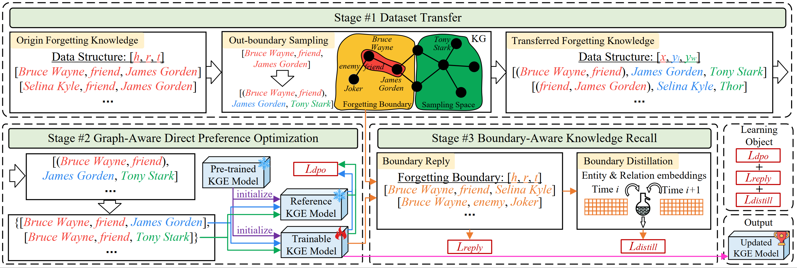

# GraphDPO

The codes for our paper **Unlearning of Knowledge Graph Embedding via Preference Optimization**.

## 📖 Overview

This repository contains the official implementation of **GraphDPO**, a novel approach for knowledge graph embedding unlearning via preference optimization. Our method enables efficient and effective removal of specific knowledge from pre-trained knowledge graph embeddings without requiring complete retraining.

## 🏗️ Framework

<div align="center">
  
</div>

## 📁 Project Structure

```
GraphDPO/
├── 📂 checkpoint_pretrain/     # Pre-trained model checkpoints
├── 📂 checkpoint_unlearning/   # Unlearning model checkpoints  
├── 📂 data/                    # Dataset files
│   ├── fb15k-237-10.zip
│   ├── fb15k-237-20.zip
│   ├── wn18rr-10.zip
│   └── wn18rr-20.zip
├── 📂 logs/                    # Training logs
├── 📂 src/                     # Source code
│   ├── 📂 data_load/          # Data loading utilities
│   ├── 📂 model/              # Model implementations
│   ├── parse_args.py          # Argument parsing
│   ├── test.py                # Testing scripts
│   ├── train.py               # Training scripts
│   ├── unlearning_parse_args.py # Unlearning arguments
│   └── utils.py               # Utility functions
├── main.sh                     # Main experiment script
├── ablation.sh                 # Ablation study script  
├── pretrain.py                 # Pre-training script
├── unlearning.py              # Unlearning script
├── requirements.txt           # Dependencies
└── README.md                  # This file
```

## 🔧 Requirements

### Hardware
- NVIDIA RTX 3090Ti GPU (or equivalent)
- Sufficient GPU memory for large knowledge graphs

### Software
- Python 3.9
- PyTorch 1.13.1
- CUDA-compatible GPU drivers

## ⚡ Quick Start

### 1. Installation

Install dependencies:

```bash
pip install -r requirements.txt
```

### 2. Data Preparation

Extract the provided datasets:

```bash
cd data
unzip fb15k-237-10.zip
unzip fb15k-237-20.zip  
unzip wn18rr-10.zip
unzip wn18rr-20.zip
cd ..
```

### 3. Pre-training

Train the base knowledge graph embedding model:

```bash
python pretrain.py
```

### 4. Run Experiments

Execute the main unlearning experiments:

```bash
bash main.sh
```

For ablation studies:

```bash
bash ablation.sh
```

## 🧪 Experimental Setup

### Datasets

We evaluate GraphDPO on the following benchmark datasets:

| Dataset | Entities | Relations | Total Triples | Description |
|---------|----------|-----------|---------------|-------------|
| **FB15K-237-10** | 14,541 | 237 | 310,116 | FB15K-237 with 10% forgetting ratio |
| **FB15K-237-20** | 14,541 | 237 | 310,116 | FB15K-237 with 20% forgetting ratio |
| **WN18RR-10** | 40,943 | 11 | 93,003 | WN18RR with 10% forgetting ratio |
| **WN18RR-20** | 40,943 | 11 | 93,003 | WN18RR with 20% forgetting ratio |
| **CO-10** | 77,951 | 69 | 612,437 | Codex-S with 10% forgetting ratio |
| **CO-20** | 77,951 | 69 | 612,437 | Codex-S with 20% forgetting ratio |
| **YA-10** | 123,182 | 37 | 1,089,040 | YAGO3-10 with 10% forgetting ratio |
| **YA-20** | 123,182 | 37 | 1,089,040 | YAGO3-10 with 20% forgetting ratio |

#### Incremental Unlearning Statistics

More static analysis  in the Appendix of our paper. 

> **Notice**: Due to the large size of YA-20 dataset (> 20 MB), we provide the complete datasets in this **anonymous github link**, but not the **Supplementary Materials (<= 50 MB)**.

### Baseline Methods

Our implementation includes comparisons with the following unlearning methods:

- **Repretrain**: Complete model retraining
- **Before**: Pre-unlearning baseline
- **Finetune**: Fine-tuning based approach
- **NG**: Negative gradient method
- **RL**: Retraction learning
- **Fisher**: Fisher information based method
- **BS**: Boundary shrinkage
- **ADVIMP**: Adversarial importance
- **SSD**: Selective synaptic dampening
- **Schema**：Unlearning baseline for KGE
- **MetaEU**: Unlearning baseline for KGE
- **GraphDPO**: Our proposed method

## 📊 Main Results

We report our main results in Table 1 of our paper, and Table 3 in the Appendix in our supplementary materials. 

## 🔍 Model Architecture

GraphDPO builds upon the TransE knowledge graph embedding model and incorporates:

- **Preference Optimization**: Novel approach for selective knowledge removal
- **Embedding Preservation**: Maintains performance on retained knowledge
- **Efficient Training**: Faster than complete retraining approaches

## 🤠 Q & A

### 🍓 01 Why choose our datasets?

The advantages of our constructed datasets compared to the previous works include:

- **Covering various scales of KGs (from 92,583 triples to 1,089,000 triples).** 
- **Covering various connections between forgetting triples and remaining triples (forgetting triples of connecting and disconnecting to remaining triples both exist).** 
- **Covering various time steps, which simulates continual unlearning.** 

### 📊 02 Is it necessary to fine-tune the hyperparameters of different blocks for different tasks? 

The answer is **No**. From the **analysis of key parameters in Figure 5** in our paper, we can observe that although our method consists of three components, **the sensitivity of the three components to parameters is very low**. In other words, we **do not need to fine-tune the parameters for specific datasets or tasks**; we can achieve good results by **simply maintaining the original parameters**.

### 📲 03 How to implement our GraphDPO based on other KGE models in code?

We have provided our method's adaptation code for other KGE models (**lines 136-659** in *src\model\GraphDPO.py*), and the results are published in **Table 4 of the paper**. From **lines 136-659** in *src\model\GraphDPO.py*, we can see that our method can be adapted to various KGE models.

##  😀 License

This project is licensed under the MIT License.

## 🙏 Acknowledgments

We thank the authors of the baseline methods and dataset providers for making their code and data available.